# DevFlow

<p align="center">
  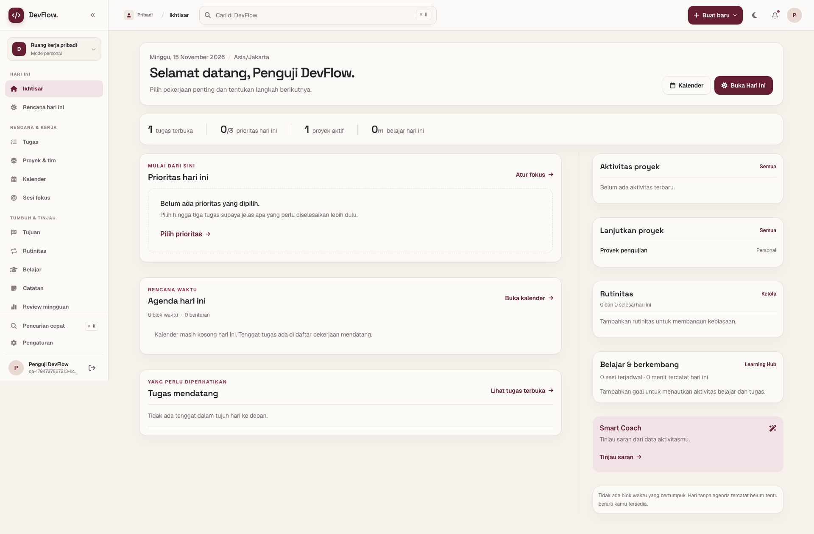
</p>

<h3 align="center">Kerja fokus. Tumbuh konsisten.</h3>

<p align="center">
  Satu workspace untuk merencanakan proyek, mengubah dokumen menjadi pekerjaan, dan kembali bekerja tanpa kehilangan konteks.
</p>

<p align="center">
  <a href="https://devflow.fdevsite.cloud"><strong>Buka DevFlow</strong></a>
  · <a href="#fitur-utama">Jelajahi fitur</a>
  · <a href="#menjalankan-secara-lokal">Jalankan secara lokal</a>
</p>

<p align="center">
  <a href="https://github.com/ferdykp/devflow/actions/workflows/quality.yml"></a>
  
  
  
</p>

DevFlow membantu menjawab tiga hal: **apa yang sedang dikerjakan, apa langkah berikutnya, dan bagaimana melanjutkan pekerjaan setelah berpindah konteks.** Mulai dari daftar tugas sederhana; PRD, GitHub, dan Smart Coach tersedia saat dibutuhkan.

### Kenapa DevFlow

- **Dari dokumen ke pekerjaan:** impor PRD Markdown/TXT, tinjau draf hasil ekstraksi, lalu pilih tugas yang ingin dibuat.
- **Proyek tetap punya konteks:** simpan PRD, keputusan scope, milestone, catatan, dan aktivitas dalam satu ruang kerja.
- **Lanjutkan dengan jelas:** lihat pekerjaan terbuka dan aktivitas terbaru sebelum kembali mengerjakan proyek.
- **Alur kerja sederhana:** papan tugas merangkum pekerjaan menjadi *Belum dikerjakan*, *Sedang dikerjakan*, dan *Selesai*.
- **Integrasi sesuai kebutuhan:** GitHub bersifat opsional dan sinkronisasi repositori hanya-baca.

## Galeri tampilan

### Workspace dan eksekusi

| Daftar proyek | Fokus harian |
| --- | --- |
| 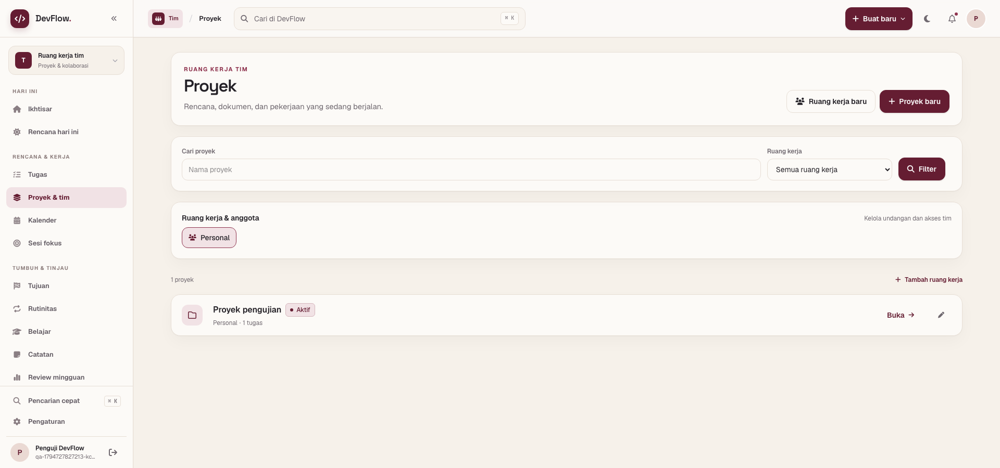 | 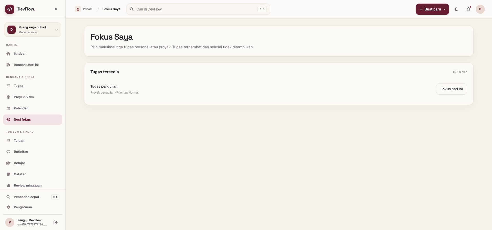 |

| Lanjutkan pekerjaan | Diskusi tugas |
| --- | --- |
| 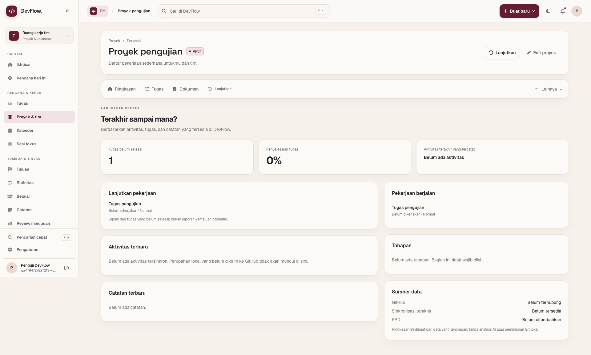 | 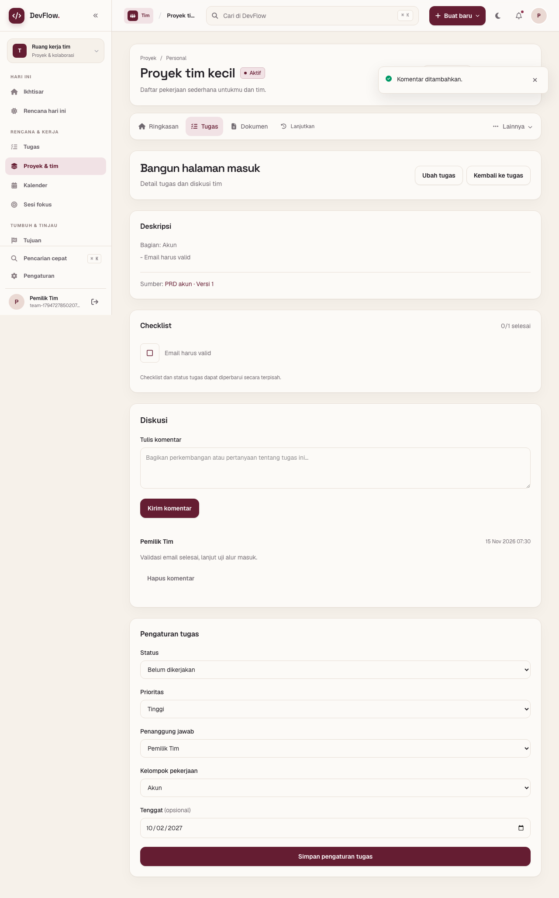 |

### Dokumen menjadi pekerjaan

| Impor dokumen Markdown | Tugas hasil ekstraksi dokumen |
| --- | --- |
| 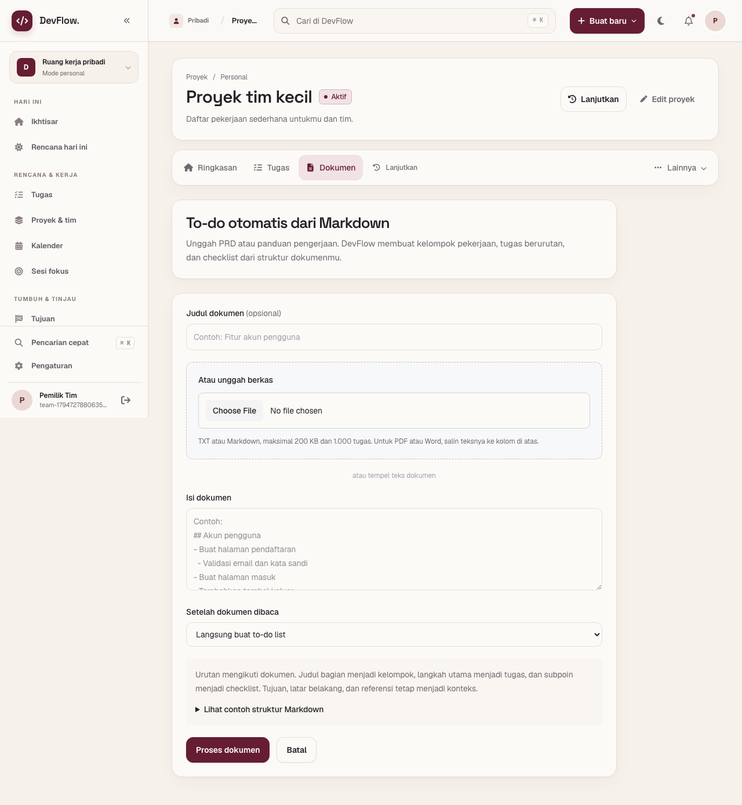 | 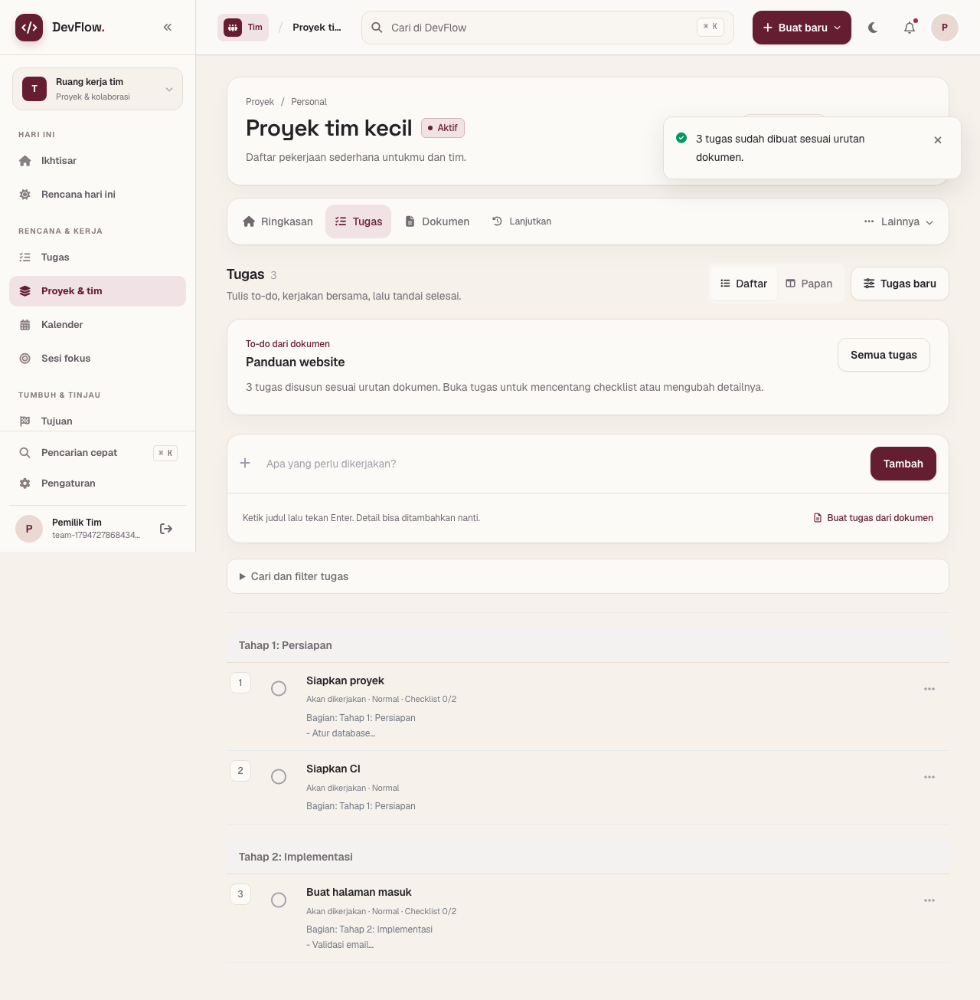 |

| Tinjau draf tugas sebelum dibuat | Detail tugas dan diskusi tim |
| --- | --- |
| 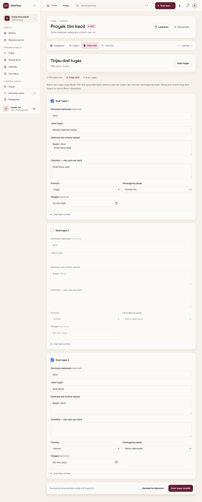 |  |

### Perencanaan dan konteks proyek

| Penjaga cakupan proyek | Integrasi GitHub |
| --- | --- |
| 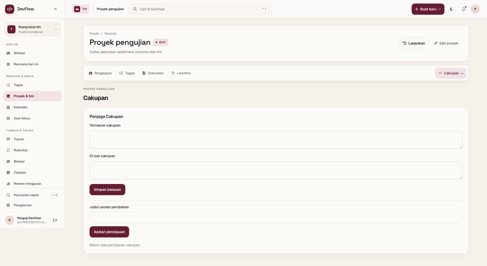 | 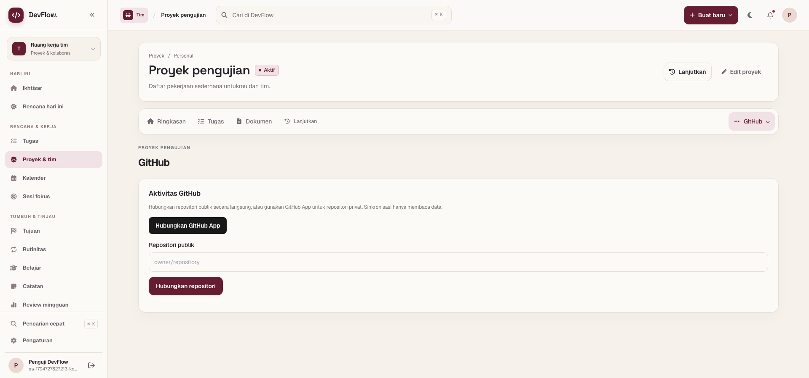 |

| Backlog ide | Dokumen proyek |
| --- | --- |
| 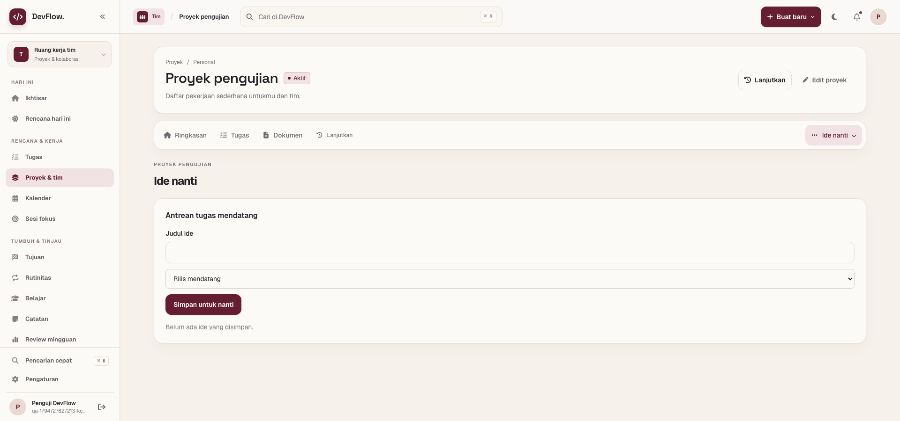 | 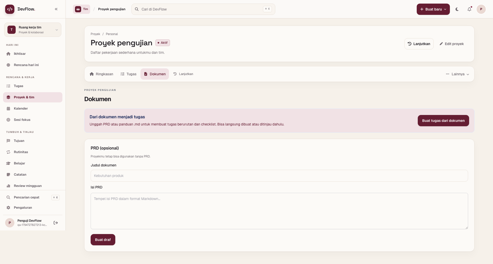 |

## Fitur utama

### 1. Perencanaan proyek yang lentur

- Buat beberapa workspace personal atau tim dan kelola proyek aktif, tertunda, atau arsip.
- Mulai proyek cukup dengan nama; PRD, milestone, dan koneksi GitHub bersifat opsional.
- Catat tujuan, milestone, catatan proyek, aktivitas, dan ide yang belum masuk rencana kerja.
- Gunakan tampilan daftar atau papan yang merangkum tugas menjadi tiga tahap: belum dikerjakan, sedang dikerjakan, dan selesai. Status seperti review atau terhambat tetap tersedia sebagai rincian.
- Kelola prioritas, tenggat, checklist, komentar, penanggung jawab, dan riwayat perubahan tugas.

### 2. Impor dokumen menjadi daftar tugas

- Tempel atau unggah dokumen Markdown/TXT seperti PRD dan panduan kerja.
- DevFlow membaca judul bagian sebagai kelompok pekerjaan, langkah utama sebagai tugas, dan subpoin sebagai checklist.
- Periksa judul, deskripsi, checklist, prioritas, penanggung jawab, dan tenggat sebelum membuat tugas.
- Pilih tugas yang diperlukan; draf yang tidak dipilih tidak dibuat.

### 3. PRD dan pengendalian perubahan scope

- Simpan PRD dalam Markdown dengan draf, versi, dan alur persetujuan.
- Tetapkan baseline pekerjaan yang termasuk dan di luar cakupan, dengan atau tanpa PRD.
- Ajukan review saat ada usulan perubahan; catat klasifikasi, alasan, dan keputusan.
- Simpan ide di backlog masa depan agar usulan baru tidak otomatis berubah menjadi tugas aktif.
- Versi PRD yang sudah disetujui menjadi riwayat; perubahan berikutnya dibuat sebagai versi baru.

### 4. Lanjutkan proyek dengan konteks yang jelas

- Halaman **Lanjutkan** merangkum tugas terbuka, aktivitas terbaru, milestone, catatan, dan sumber data yang tersedia.
- Tampilkan waktu sinkronisasi GitHub jika integrasi dipakai, sehingga pengguna bisa menilai kebaruan datanya.
- Ringkasan mengikuti data yang tercatat; DevFlow tidak menganggap commit sebagai bukti tugas selesai atau mengarang persentase progres.

### 5. Sinkronisasi GitHub opsional

- Hubungkan repositori publik atau instal GitHub App untuk repositori privat.
- Sinkronisasi bersifat baca-saja untuk aktivitas repositori dan dapat menampilkan perubahan di aktivitas proyek.
- GitHub App menggunakan izin repositori minimal untuk membaca metadata dan konten yang diperlukan.
- Pekerjaan manual tetap bisa dikelola ketika GitHub belum dikonfigurasi.

### 6. Rencana kerja dan fokus personal

- Dashboard merangkum tugas terbuka, tiga prioritas harian, agenda, proyek, rutinitas, dan sesi belajar.
- Pilih hingga tiga tugas fokus, lalu tandai selesai atau tunda dari halaman Hari Ini.
- Kelola tugas pribadi lintas proyek melalui inbox, termasuk filter, checklist, komentar, dan pembaruan beberapa tugas sekaligus.
- Atur kalender, sesi fokus, rutinitas harian, tujuan, dan review mingguan dalam workspace yang sama.

### 7. Belajar dan Smart Coach

- Susun jalur belajar menjadi modul dan pelajaran; catat sesi, materi, asesmen, serta jadwal review.
- Pantau tujuan melalui target angka atau milestone.
- Smart Coach memberi saran berbasis aturan dari data tugas, agenda, rutinitas, dan belajar—misalnya tenggat terlewat atau jadwal bertumpuk.
- Saran transparan dan perlu dikonfirmasi pengguna; Coach tidak mengubah jadwal atau menyelesaikan tugas sendiri.

### 8. Kolaborasi dan akses

- Buat workspace tim, undang anggota melalui tautan undangan, dan cabut undangan yang belum dipakai.
- Diskusikan tugas lewat komentar dan tetapkan penanggung jawab.
- Akses proyek mengikuti workspace yang dimiliki atau dapat diakses anggota.

### 9. Pengalaman web

- Antarmuka responsif untuk desktop dan layar kecil.
- Mendukung instalasi sebagai PWA melalui web manifest.
- Saat offline, DevFlow menampilkan halaman informasi; data proyek pribadi tidak disimpan di perangkat.
- Tersedia autentikasi email, verifikasi email, pemulihan kata sandi, serta login Google opsional.

## Teknologi

- **Backend:** PHP 8.3+, Laravel 13
- **UI:** Blade, Tailwind CSS 4
- **Aset frontend:** Vite
- **Database default:** SQLite; konfigurasi koneksi mengikuti Laravel
- **Integrasi:** GitHub App/webhook dan Google OAuth (opsional)

## Menjalankan secara lokal

Prasyarat: PHP 8.3+, Composer, Node.js, dan npm.

```bash
git clone https://github.com/ferdykp/devflow.git
cd devflow
touch database/database.sqlite
composer setup
```

Perintah `composer setup` menginstal dependensi, menyiapkan `.env`, membuat application key, menjalankan migrasi, menginstal dependensi frontend, dan membangun aset.

Jalankan aplikasi dan Vite di terminal terpisah:

```bash
php artisan serve
```

```bash
npm run dev
```

Buka `http://localhost:8000`. Untuk menambahkan data contoh di database lokal:

```bash
php artisan db:seed --class=DevFlowDemoSeeder
```

Seeder demo membuat akun `demo@devflow.local` dengan kata sandi `Devdemo123.`. Kredensial ini hanya untuk lingkungan lokal.

## Integrasi opsional

Kredensial Google OAuth, SMTP, dan GitHub App dapat diisi di `.env`. Petunjuk konfigurasi GitHub App dan webhook tersedia di [`docs/GITHUB-APP-SETUP.md`](docs/GITHUB-APP-SETUP.md). Aplikasi inti tetap dapat digunakan tanpa integrasi tersebut.

## Lisensi

MIT — lihat metadata proyek di [`composer.json`](composer.json).
