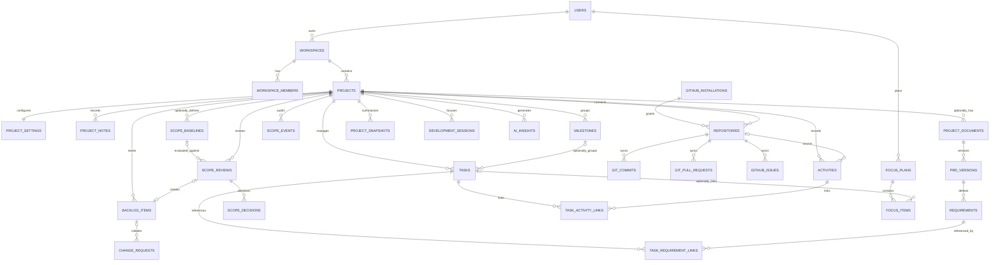

# DevFlow — ERD & MySQL Migration Specification

**DB:** MySQL 8.0+ InnoDB, `utf8mb4`; Laravel 12 migrations/Eloquent.  
**Objective:** optional project capabilities without placeholder/dummy PRDs or mandatory milestones.

## 1. Modeling principles

- Use Laravel `id()` BIGINT UNSIGNED PK, `foreignId()->constrained()`, restrictive `cascadeOnDelete()` only for true dependent records; prefer `restrictOnDelete()` for audit/scope data.
- Keep `tasks.project_id` required and `tasks.milestone_id` **nullable**; PRD is NOT FK on projects/tasks.
- MySQL `json()` for metadata/snapshots; validate payload in application/Form Request. Index searchable scalar columns; avoid filtering large JSON blobs.
- Dates/times stored as UTC, rendered user timezone. Use `timestamp`/`dateTime` consistently; explicit cast in Eloquent.
- GitHub IDs use `unsignedBigInteger` where in numeric range; webhook delivery UUID-like value string unique. Commit SHA `char(40)` (SHA-1 typical) but allow wider `varchar(64)` to future-proof if necessary.
- Application must verify related entities belong to the same project/workspace; ordinary FKs alone do not enforce that.
- Approval/version snapshots are append-only in content. Enforce at service/policy layer and through DB-level constraints where practical.

## 2. Entity relationships



## 3. Table-by-table schema

### Identity and projects

| Table               | Key columns / constraints                                                                                                                                                           |
| ------------------- | ----------------------------------------------------------------------------------------------------------------------------------------------------------------------------------- |
| `users`             | Laravel default, email unique, password hashed                                                                                                                                      |
| `workspaces`        | id, owner_id FK, name, slug, timestamps; unique(owner_id,slug)                                                                                                                      |
| `workspace_members` | workspace_id FK, user_id FK, role enum-like string owner/admin/member; unique(workspace_id,user_id)                                                                                 |
| `projects`          | workspace_id FK, name, slug, description nullable, goal nullable, status active/paused/archived, priority, target_date nullable, timestamps, softDeletes; unique(workspace_id,slug) |
| `project_settings`  | project_id FK unique, preferences JSON (feature toggles, privacy and defaults), timestamps                                                                                          |
| `project_notes`     | project_id FK, user_id FK, title nullable, body text, pinned boolean, timestamps                                                                                                    |

### Planning

| Table                    | Key columns / constraints                                                                                                                                                                                                                       |
| ------------------------ | ----------------------------------------------------------------------------------------------------------------------------------------------------------------------------------------------------------------------------------------------- |
| `milestones`             | project_id FK, title, status, due_date nullable, sort_order, timestamps                                                                                                                                                                         |
| `tasks`                  | project_id FK required, milestone_id nullable FK, title, description text nullable, status, priority, weight unsigned int default 1, due_date nullable, completed_at nullable, completion_source nullable, sort_order, timestamps               |
| `task_requirement_links` | task_id FK, requirement_id FK, unique(task_id,requirement_id)                                                                                                                                                                                   |
| `backlog_items`          | project_id FK, scope_review_id nullable unique FK, title, description, category, bucket future/research/someday, status proposed/under_review/promoted/rejected/archived, priority, source, decision_reason, created_by FK nullable, timestamps |

### PRD and scope

| Table               | Key columns / constraints                                                                                                                                                                                                                                                                  |
| ------------------- | ------------------------------------------------------------------------------------------------------------------------------------------------------------------------------------------------------------------------------------------------------------------------------------------ |
| `project_documents` | project_id FK, document_type, title, created_by FK nullable, timestamps                                                                                                                                                                                                                    |
| `prd_versions`      | document_id FK, version_number unsigned, status draft/approved/superseded, content_markdown LONGTEXT, content_hash CHAR(64), approved_by nullable, approved_at nullable, timestamps; unique(document_id,version_number)                                                                    |
| `requirements`      | prd_version_id FK, requirement_key, title, description, priority, acceptance_criteria JSON, timestamps; unique(prd_version_id,requirement_key)                                                                                                                                             |
| `scope_baselines`   | project_id FK, prd_version_id nullable FK, baseline_type prd/project_scope/milestone_commitment, scope_definition JSON, status draft/active/superseded, approved_at nullable, timestamps                                                                                                   |
| `scope_reviews`     | project_id FK, baseline_id nullable FK, prd_version_id nullable FK, source_type, source_reference nullable, proposed_title, proposed_description, classification, confidence decimal(4,3) nullable, reasoning nullable, evidence JSON nullable, review_status pending/resolved, timestamps |
| `scope_decisions`   | scope_review_id FK, decision, reason, decided_by FK, decided_at, timestamps                                                                                                                                                                                                                |
| `change_requests`   | project_id FK, backlog_item_id nullable FK, base_prd_version_id nullable FK, title, justification, impact_analysis JSON, status, requested_by, reviewed_by nullable, reviewed_at nullable, timestamps                                                                                      |
| `scope_events`      | project_id FK, entity_type, entity_id, action, actor_id nullable, payload JSON, created_at; append-only                                                                                                                                                                                    |

### GitHub and intelligence

| Table                  | Key columns / constraints                                                                                                                                                                                                  |
| ---------------------- | -------------------------------------------------------------------------------------------------------------------------------------------------------------------------------------------------------------------------- |
| `github_installations` | owner_user_id FK, github_installation_id unique, account_login, account_type, suspended_at nullable, timestamps; credentials/private key stored server-side not on row as plain text                                       |
| `repositories`         | project_id FK, github_installation_id FK (internal PK), github_repository_id unique, owner, name, default_branch, is_private, sync_status, last_synced_at, timestamps                                                      |
| `webhook_deliveries`   | delivery_id VARCHAR(100) unique, github_event, installation_id nullable, status, received_at, processed_at nullable, error_summary nullable                                                                                |
| `git_commits`          | repository_id FK, sha varchar(64), message text, author_name nullable, authored_at nullable, committed_at nullable, timestamps; unique(repository_id,sha)                                                                  |
| `git_pull_requests`    | repository_id FK, github_pr_id unique, number, title, state, merged_at nullable, updated_at_remote, timestamps                                                                                                             |
| `github_issues`        | repository_id FK, github_issue_id unique, number, title, state, updated_at_remote, timestamps                                                                                                                              |
| `activities`           | project_id FK, repository_id nullable FK, event_type, source, source_event_id, title, description nullable, metadata JSON, occurred_at, timestamps; unique(source,source_event_id) (use stable globally-scoped source IDs) |
| `task_activity_links`  | task_id FK, activity_id FK, confidence nullable, link_source, unique(task_id,activity_id)                                                                                                                                  |
| `project_snapshots`    | project_id FK, summary, open_work JSON, next_steps JSON, evidence_ids JSON, latest_activity_at nullable, generated_at, created_at                                                                                          |
| `development_sessions` | project_id FK, user_id FK, task_id nullable FK, started_at, ended_at nullable, objective nullable, generated_context LONGTEXT nullable                                                                                     |
| `focus_plans`          | user_id FK, plan_date, timezone, status, timestamps; unique(user_id,plan_date) for user's chosen local date                                                                                                                |
| `focus_items`          | focus_plan_id FK, project_id FK, task_id nullable FK, title, rank, status, timestamps; unique(focus_plan_id,rank)                                                                                                          |
| `ai_insights`          | project_id FK, insight_type, provider, model nullable, status, content JSON, evidence_ids JSON, generated_at, timestamps                                                                                                   |

## 4. Migration snippets (executable patterns)

### projects, project_settings, and optional task milestone

```php
Schema::create('projects', function (Blueprint $table) {
    $table->id();
    $table->foreignId('workspace_id')->constrained()->restrictOnDelete();
    $table->string('name');
    $table->string('slug');
    $table->text('description')->nullable();
    $table->text('goal')->nullable();
    $table->string('status', 20)->default('active');
    $table->string('priority', 20)->default('normal');
    $table->date('target_date')->nullable();
    $table->timestamps();
    $table->softDeletes();
    $table->unique(['workspace_id', 'slug']);
});
Schema::create('project_settings', function (Blueprint $table) {
    $table->id();
    $table->foreignId('project_id')->unique()->constrained()->cascadeOnDelete();
    $table->json('preferences')->nullable();
    $table->timestamps();
});
Schema::create('milestones', function (Blueprint $table) {
    $table->id();
    $table->foreignId('project_id')->constrained()->restrictOnDelete();
    $table->string('title');
    $table->string('status', 20)->default('open');
    $table->date('due_date')->nullable();
    $table->unsignedInteger('sort_order')->default(0);
    $table->timestamps();
});
Schema::create('tasks', function (Blueprint $table) {
    $table->id();
    $table->foreignId('project_id')->constrained()->restrictOnDelete();
    $table->foreignId('milestone_id')->nullable()->constrained()->nullOnDelete();
    $table->string('title');
    $table->text('description')->nullable();
    $table->string('status', 24)->default('todo');
    $table->string('priority', 20)->default('normal');
    $table->unsignedInteger('weight')->default(1);
    $table->date('due_date')->nullable();
    $table->timestamp('completed_at')->nullable();
    $table->string('completion_source', 30)->nullable();
    $table->unsignedInteger('sort_order')->default(0);
    $table->timestamps();
    $table->index(['project_id','status']);
});
```

**Important:** Validate that a chosen `milestone_id` belongs to the task's `project_id`; nullable FK alone does not enforce same-project linkage.

### PRD versions and scope reviews

```php
Schema::create('prd_versions', function (Blueprint $table) {
    $table->id();
    $table->foreignId('document_id')->constrained('project_documents')->restrictOnDelete();
    $table->unsignedInteger('version_number');
    $table->string('status', 20)->default('draft');
    $table->longText('content_markdown');
    $table->char('content_hash', 64)->nullable();
    $table->foreignId('approved_by')->nullable()->constrained('users')->nullOnDelete();
    $table->timestamp('approved_at')->nullable();
    $table->timestamps();
    $table->unique(['document_id','version_number']);
});
Schema::create('scope_reviews', function (Blueprint $table) {
    $table->id();
    $table->foreignId('project_id')->constrained()->restrictOnDelete();
    $table->foreignId('baseline_id')->nullable()->constrained('scope_baselines')->nullOnDelete();
    $table->foreignId('prd_version_id')->nullable()->constrained('prd_versions')->nullOnDelete();
    $table->string('source_type', 30);
    $table->string('source_reference')->nullable();
    $table->string('proposed_title');
    $table->text('proposed_description')->nullable();
    $table->string('classification', 40)->default('not_assessable');
    $table->decimal('confidence', 4, 3)->nullable();
    $table->text('reasoning')->nullable();
    $table->json('evidence')->nullable();
    $table->string('review_status', 20)->default('pending');
    $table->timestamps();
    $table->index(['project_id','review_status']);
});
```

For `prd_versions` active approved uniqueness, MySQL lacks PostgreSQL-style partial unique indexes. Use a locked `project_documents.current_approved_version_id` pointer (nullable FK in a later migration), update pointer and version statuses **in one transaction**, validate version belongs to document, prevent editing approved contents at service level. Consider triggers only if threat model warrants them.

## 5. Key state machines

- Task: backlog → todo → in_progress → in_review → done; blocked/cancelled/reopened explicit.
- Backlog item: proposed → under_review → promoted/rejected/archived.
- Scope review: pending → resolved.
- PRD: draft → approved → superseded; never edit approved snapshot content.
- Scope classification: in_scope, potential_out_of_scope, focus_misalignment, unplanned, uncertain, not_assessable.

## 6. Transaction: Move to Future Backlog

1. Authorize project/actor, validate bucket `future|research|someday`, ensure request belongs to project.
2. `DB::transaction`: `SELECT ... FOR UPDATE` pending scope review.
3. Insert `backlog_items` (unique scope_review_id for one generated idea).
4. Insert `scope_decisions` with actor/reason.
5. Mark review resolved; insert append-only `scope_events`.
6. Commit. Do **not** update `prd_versions`, active tasks, or milestone progress.
7. Duplicate submission: return existing decision safely or 409; never create duplicate.

## 7. Index, deletion, and scale guidance

- Index: `projects(workspace_id,status)`, `tasks(project_id,status,due_date)`, `activities(project_id,occurred_at)`, `repositories(project_id)`, `scope_reviews(project_id,review_status)`, `backlog_items(project_id,status,bucket)`.
- Honor audit retention: restrict PRD/scope record hard deletes; archive projects instead.
- Avoid polymorphic FK for critical associations when strong relational integrity is required; `scope_events` uses generic entity references only for audit.
- Use pagination/keyset strategy for long activity feeds; eager loading to avoid N+1.
- Use model casts for JSON/date and Form Requests for all enums and relational validation.

## 8. Migration order

1. Laravel default auth/system tables; 2. workspaces/members/projects/settings; 3. milestones/tasks/notes/backlog base; 4. GitHub installations/repositories/webhooks/commits/PR/issues/activities; 5. PRD docs/versions/requirements; 6. scope baselines/reviews/decisions/events/change requests; 7. task_requirement_links and task_activity_links; 8. snapshots/sessions/focus/AI. For `backlog_items.scope_review_id` add nullable FK in an **alter migration after scope_reviews** to avoid circular creation dependency.

## 9. Required tests

- Project creation without PRD/GitHub/tasks.
- Task without milestone; task/milestone cross-project validation.
- Approved PRD edit forbidden; version reapproval race handled with document lock.
- No baseline → `not_assessable`, not definitive out-of-scope.
- Move to backlog atomic/idempotent; progress unchanged.
- Webhook signature failure rejected; duplicate deliveries skipped.
- Workspace-user resource isolation, soft-deleted project behavior.
