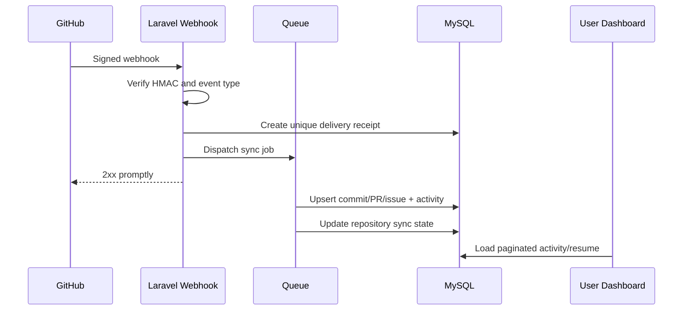
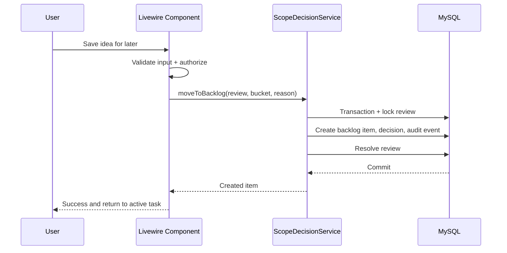

# DevFlow — User Flows and Information Architecture

**Baseline:** adaptable Full Laravel workspace; no mandatory PRD, GitHub, tasks, AI, or milestone.

## 1. Navigation hierarchy
```text
App
├── Overview
├── Projects
│   ├── All projects / Create project
│   └── Project detail
│       ├── Overview (always)
│       ├── Tasks (always accessible, empty state)
│       ├── Notes (always)
│       ├── Backlog (always)
│       ├── Activity (if data / connect CTA)
│       ├── Resume (always, truthful empty/basic state)
│       ├── Milestones (if enabled / create CTA)
│       ├── Documents & PRD (if available / add CTA)
│       ├── Scope review (if baseline, or idea-only mode)
│       └── Settings / Integrations
├── My Focus
├── Activity (cross-project)
├── Future Backlog
├── AI Insights (optional)
└── Settings / GitHub / AI / Account
```

## 2. Journey A — onboarding: name only
**Trigger:** New user wants to track a project immediately.
1. Register/login; personal workspace auto-created.
2. Click `New project`.
3. Enter name (required); optional description/goal.
4. Submit → create project and default settings in one transaction.
5. Redirect to Overview; show `Add task`, `Write note`, `Connect GitHub`, `Add PRD` as optional actions.
6. User creates a note, idea or task; never blocked by PRD prompt.
**Success:** Project useful with no integrations.
**Error states:** duplicate slug, forbidden workspace, validation preserving input.

## 3. Journey B — GitHub-only project
1. On project, click `Connect GitHub`.
2. App installation/authorization (only selected repositories).
3. Select repository, link to project, queue initial backfill.
4. Project view shows `Syncing` and last-sync status.
5. Events arrive by webhook, validated and queued; timeline updates.
6. Resume shows last known remote activity and explicit sync time.
**Important:** no PRD implies `Not estimated` project completion, NOT zero percent; no GitHub local unpushed tracking.
**Fallback:** GitHub outage keeps notes/tasks/local saved history usable.

## 4. Journey C — optional PRD added later
1. User chooses `Add PRD` to existing project.
2. Draft from text/Markdown; PDF/DOCX ingestion deferred until supported.
3. User reviews proposed requirements and acceptance criteria.
4. User approves version v1 (requires confirmation and validation).
5. Scope baseline created referencing approved version.
6. Existing tasks are **not silently overwritten**; user may link old tasks to new requirements.
**Success:** Historical activities unchanged; Scope Guardian now has formal reference.

## 5. Journey D — idea and Move to Future Backlog
1. New idea from user or AI suggestion (external AI needs paste/manual input unless integrated).
2. If approved baseline exists: compare candidate to scope and show evidence/uncertainty.
3. If no baseline: classify `not_assessable` or `unplanned`; no definitive violation.
4. User chooses `Move to Future Backlog`, bucket (future/research/someday), optional reason.
5. Server validates policy/project match; locks review, creates backlog item + scope decision + event in single transaction.
6. Show success, active task unchanged, PRD unchanged, no % impact.
7. User can revisit, archive, or request change later.
**Edge case:** If change already coded, surface a separate `implementation action required` note; never auto-revert Git.

## 6. Journey E — resume after a gap
1. Open project from overview / recent list.
2. Project Resume assembles latest persisted task status, notes, Git activities, and baseline when present.
3. Shows **Last known activity**, **Open work**, **Next suggested step**, **Evidence**, **Last sync**.
4. If no data: `No development history yet — add a note or connect GitHub`; never invent tasks.
5. User clicks a task, opens GitHub commit, or copies context for coding assistant.

## 7. Journey F — daily focus
1. Open My Focus.
2. Rule-based planner ranks task candidates by deadline, explicit priority, urgency, readiness, inactivity (weights configurable).
3. Recommend up to three, with reasons; exclude paused projects and show blockers distinctly.
4. User changes selections or creates manual focus without tasks.
5. Focus session builds a copyable context with allowed scope, acceptance criteria, optional PRD.
6. End session optionally leave quick note; no compulsory end-of-day reporting.

## 8. Journey G — change request
1. Open saved backlog item.
2. Click `Propose scope change`.
3. Fill justification, impact and target milestone/release.
4. Approve/reject explicitly (single-user approval now, roles later).
5. If PRD exists: create next draft; approval of change request **does not mutate** approved PRD; final PRD approval is separate.
6. If no PRD: user can promote to active task/approved project scope, with audit log.

## 9. Journey H — commit assistant (later)
1. In local CLI, run command after `git add`.
2. Inspect `git diff --cached`; redact likely secrets; prompt for local/external AI approval.
3. Show 1–3 Conventional Commit suggestions with task ID when known.
4. User selects/edits; commit only after explicit confirmation. Push remains separate.
5. Web receives activity only after remote push.

## 10. System sequence: GitHub event


## 11. System sequence: Move to Backlog


## 12. UX states to design for every module
- Default / empty / loading / success / validation failure / permission denied / integration disconnected / sync delayed / error and retry.
- Mobile 360/390px, tablet, desktop at 1440px; keyboard, dark mode, reduced motion.
- Source/freshness on AI cards; no misleading completion %. All destructive actions use accessible confirmation dialogs, not browser `confirm()`.
